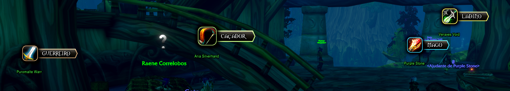
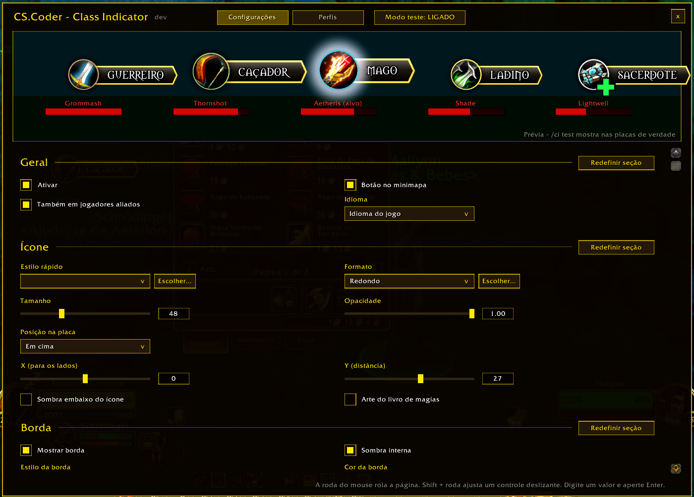

# CS.Coder - Class Indicator

The official class icon and the class name above every enemy player's nameplate, so you know at a glance
whether it's a Hunter, a Mage or a Warrior, without relying on colors.

## Why

I made it because colors don't work well for me: in PvP, with nameplates on, I couldn't reliably tell allies from enemies,
or one class from another. The goal is simple: the official class icon (and the class name, if you want it) above
every enemy player, so you know who's who at a glance. Feedback and ideas are very welcome.

Made for **WoW Forever**. Works with the default nameplates and with nameplate addons such as Plater.

## Features

- **Official class icons** (character-creation or spellbook art) in six shapes: round, rounded square, square, hexagon, diamond, shield.
- **Borders:** soft frame, soft glow, flat color or metal shine, in the class color, gold, enemy red or your own color.
- **Class name:** full ("Hunter") or short ("HUN"), font, size, color, outline, shadow and position, with an optional badge, plate or ribbon behind it.
- **PvP helpers:** a green cross on classes that can heal, a bigger icon and a pulsing glow on your target, bigger icons for the classes you pick.
- **Quick styles** and visual pickers, a live preview, and a **test mode** (`/ci test`) that puts sample classes on every nameplate so you can tune it anywhere.
- **Profiles** per character, with export / import.
- Shared **CS.Coder minimap button** (one button for every CS.Coder addon).
- English, Português, Español, Deutsch, Français, Italiano.

## Commands

- `/ci` open the options
- `/ci test` test mode on / off
- `/ci toggle` turn the addon on / off

## Notes

- Inside dungeons, raids and battlegrounds the game may lock nameplates for every addon.
- AI Disclaimer: the code was written with the help of Claude (Anthropic), under my direction and tested in game by me; the logo was made with ChatGPT.

## License

MIT
