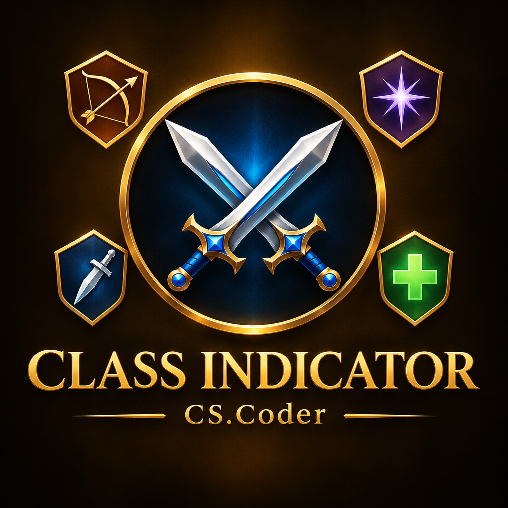

# CurseForge page (copy from here; the docs folder is not packaged)

## Project settings

- **Name:** CS.Coder - Class Indicator
- **Summary (under 100 characters):** The official class icon and class name above enemy nameplates. Know every class at a glance.
- **Game:** World of Warcraft. **Game version:** WoW Forever (1.60.x).
- **Main category:** PvP. **Extra categories:** Combat, Unit Frames (nameplates).
- **License:** MIT.
- **Project avatar:** `logo.png`.
- **Source:** https://github.com/cscoder69/CSCoder_ClassIndicator
- **Issues:** https://github.com/cscoder69/CSCoder_ClassIndicator/issues

## Description (choose "Markdown" in the editor, then paste everything below the line)

---

**Know every enemy class at a glance.** Class Indicator puts the **official class icon** and the **class name** above every enemy player's nameplate, so you can tell a Hunter from a Mage or a Warrior in a split second, without relying on colors.

Works with the **default nameplates** and with nameplate addons such as **Plater**.

### Highlights

- **Official class icons** in six shapes: round, rounded square, square, hexagon, diamond and shield. Classic or spellbook art.
- **Borders that look good:** soft frame, soft glow, flat color or metal shine, in the class color, gold, enemy red or your own color. Inner shade and a glass shine for depth.
- **Class name your way:** full ("Hunter") or short ("HUN"), font, size, color, outline, shadow and position, with a **badge**, plate or ribbon behind it.
- **PvP helpers:**
  - a green cross on classes that **can heal**
  - a **bigger icon** and a **pulsing glow** on your current target
  - **bigger icons** for the classes you fear the most
- **Quick styles** in one click, and **visual pickers** that show every choice drawn for real.
- **Live preview** in the options, and a **test mode** (`/ci test`) that puts sample classes on every nameplate around you, so you can tune it anywhere.
- **Profiles** per character, with export / import.
- One shared **CS.Coder minimap button** for all CS.Coder addons.
- **6 languages:** English, Português, Español, Deutsch, Français, Italiano.

### Commands

- `/ci` opens the options
- `/ci test` turns the test mode on / off
- `/ci toggle` turns the addon on / off

### Notes

- Made for **WoW Forever**.
- Inside dungeons, raids and battlegrounds the game can lock nameplates for every addon; the icons come back when you leave.
- Class names come from the game itself, in your game's language.

**AI Disclaimer:** the code was written with the help of Claude (Anthropic); the logo was made with ChatGPT.

Found a bug or have an idea? Open an issue on [GitHub](https://github.com/cscoder69/CSCoder_ClassIndicator/issues).

---

## Screenshots to upload (Images tab, in this order)

| File | Title | Description |
|---|---|---|
| `screenshot_test.png` | Every class at a glance | Official class icon, class name and a ribbon above each enemy player. |
| `screenshot_world.png` | PvP helpers | Healer cross, bigger glowing icon on your target, any shape. |
| `screenshot_options.png` | Options window | Sections with reset buttons, live preview, 6 languages. |
| `screenshot_picker.png` | Quick styles | Eight ready-made looks, each drawn for real before you pick it. |
